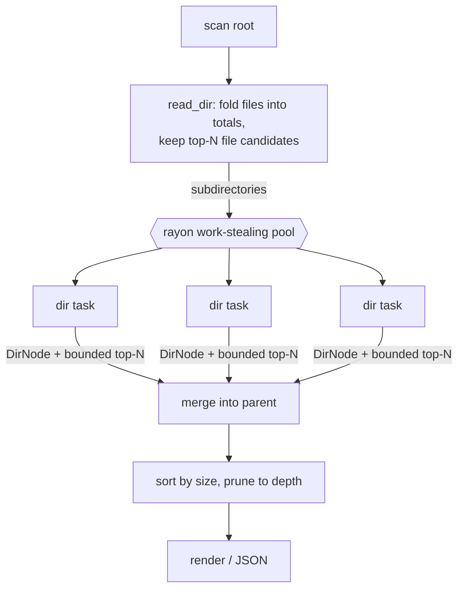

# disklens

Fast, parallel disk usage analysis. Shows the largest directories as a tree and the largest individual files, with totals identical to GNU `du`.

<details>
<summary><strong>Contents</strong></summary>

- [Why](#why)
- [Usage](#usage)
- [Options](#options)
- [Sizes: on disk vs apparent](#sizes-on-disk-vs-apparent)
- [What is counted](#what-is-counted)
- [Exit codes](#exit-codes)
- [JSON output](#json-output)
- [Recipes](#recipes)
- [Platform notes](#platform-notes)
- [Limitations](#limitations)
- [How it works](#how-it-works)

</details>

## Why

- **Fast**: directories are scanned in parallel. On the reference host, a 100,000-file tree takes 57 ms vs 505 ms for `du` (warm cache), and 0.40 s vs 2.99 s from a cold cache.
- **Trustworthy numbers**: totals match `du -B1` and `du -b` to the byte, verified on `~/.cargo`, `/usr/share`, `/usr/lib` and the benchmark fixture.
- **One view**: the largest directories *and* the largest files, so you don't need `du | sort` followed by `find -size`.
- **Scriptable**: stable JSON output and `du`-compatible exit codes.
- **Bounded memory**: memory grows with the number of directories, not files. 131k files in `/usr` needed 12.8 MiB.

## Usage

```sh
disklens                         # current directory, one level, top 10 files
disklens /var -d 3 -l 10         # three levels, at most 10 subdirectories each
disklens ~ -e node_modules -e .cache -e '*.iso'
disklens / -x -t 25              # whole root filesystem only, 25 largest files
disklens build/ --json -d 2 > usage.json
```

## Options

| Option | Default | Meaning |
|---|---|---|
| `PATH` | `.` | Directory (or single file) to analyse. A symlink given as `PATH` is followed. |
| `-d, --depth` | 1 | Tree levels to display. The scan is always complete; depth only affects output. |
| `-l, --limit` | 20 | Subdirectories shown per directory. The rest are summarised as `… N more directories`. |
| `-t, --top` | 10 | Largest files to list (0 disables). |
| `-a, --apparent` | off | Rank and display by apparent size instead of on-disk size. |
| `-e, --exclude GLOB` | — | Skip matching entries (repeatable). Without `/`, the pattern matches names; with `/`, it matches paths relative to `PATH`. Supports `*`, `?`, `**`. |
| `-x, --one-file-system` | off | Don't cross into other mounted filesystems (Unix). |
| `-j, --jobs` | CPU count | Worker threads. |
| `-b, --bytes` | off | Exact byte counts instead of KiB/MiB/GiB. |
| `--json` | off | JSON output. |
| `-v, --verbose` | off | List read errors (first 100). By default, the first 5 are shown. |

## Sizes: on disk vs apparent

| | On disk (default) | Apparent (`-a`) |
|---|---|---|
| Meaning | Blocks allocated by the filesystem | File lengths |
| Same as | `du -B1` | `du -b` / `du --apparent-size` |
| Sparse files | Only allocated blocks | Full length |
| Directories | Their own blocks are counted | 0, as in GNU du |

Both values are always included in JSON. The total line shows both.

## What is counted

- **Hard links**: a file with several links is counted once, at the first link found. The total line reports how many duplicates were skipped.
- **Symbolic links**: never followed. The link's own size is counted, as `du` does, but links are not counted as files.
- **Mount points**: crossed unless `-x` is given.
- **Special files** (sockets, FIFOs, devices): counted with their metadata size, which is usually 0.
- **Unreadable directories**: counted as errors. Their contents are missing from the totals, which are then partial, and the exit status is 1.

## Exit codes

| Code | Meaning |
|---|---|
| 0 | Complete scan. |
| 1 | Partial scan (some entries unreadable), or `PATH` is inaccessible. |
| 2 | Usage error. |

## JSON output

```json
{
  "version": 1,
  "ranked_by": "allocated",
  "root": {
    "name": "/srv", "path": "", "logical": 1950207113, "allocated": 2246705152,
    "files": 87998, "dirs": 18368,
    "children": [ { "name": "registry", "path": "registry", "logical": 1801254912, "allocated": 2052472832, "files": 84677, "dirs": 17101 } ]
  },
  "largest_files": [ { "path": "bin/cargo-nextest", "logical": 32394072, "allocated": 32395264 } ],
  "errors": 0,
  "hardlinks_deduplicated": 0,
  "symlinks_skipped": 13,
  "excluded": 0,
  "allocated_supported": true
}
```

The tree is pruned to `--depth`. Children are sorted largest first, with ties broken by name, so output is deterministic regardless of thread count. `error_samples` appears only when there were errors.

## Recipes

```sh
# Disk filling up? Biggest offenders on the root filesystem:
sudo disklens / -x -d 2 -t 20

# CI: fail if the build output exceeds 500 MiB.
size=$(disklens target/release --json -d 0 -t 0 | jq .root.allocated)
[ "$size" -lt $((500*1024*1024)) ] || { echo "build too large: $size"; exit 1; }

# Weekly report of a shared volume.
disklens /data --json -d 3 > /var/log/usage/$(date +%F).json
```

## Platform notes

- **Linux and macOS**: on-disk size comes from `st_blocks × 512`. Hard links are detected by (device, inode).
- **Windows**: on-disk size is not available without additional APIs, so it equals apparent size. JSON reports `"allocated_supported": false`, and the human view switches to apparent size automatically. Hard-link deduplication and `-x` are not available on Windows.
- CI builds and tests on Linux (x86_64, ARM64), Windows (x86_64, ARM64) and macOS (Apple Silicon); macOS x86_64 is cross-compiled only.

## Limitations

- No interactive TUI and no snapshot comparison yet (both planned).
- Very large trees with millions of *directories* use memory proportional to the directory count (about 100 bytes plus the name per directory).
- Exclusion globs don't support character classes (`[a-z]`) or brace expansion.

## How it works



Each directory is one task. A directory's files are summed into its node, and only files that could enter the top-N list get a path string allocated. Child results are merged on the way back up, so no global locks are taken on the hot path. The single exception is the hard-link inode set, which is only touched for files with more than one link.
