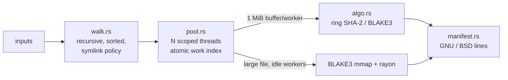

# filehash

Parallel file hashing and integrity verification with manifests compatible with GNU coreutils (`sha256sum`, `sha512sum`) and `b3sum`.

<details>
<summary><strong>Contents</strong></summary>

- [Why](#why)
- [Commands](#commands)
- [Manifest formats](#manifest-formats)
- [Options](#options)
- [Exit codes](#exit-codes)
- [JSON output](#json-output)
- [Recipes](#recipes)
- [Behaviour details](#behaviour-details)
- [Platform notes](#platform-notes)
- [Limitations](#limitations)
- [How it works](#how-it-works)

</details>

## Why

- **Compatible**: `sha256sum -c` verifies filehash manifests, and `filehash verify` verifies `sha256sum` and `b3sum` output, including BSD-tagged lines.
- **Fast on many files**: files are hashed in parallel. 10,000 files: 0.43 s vs 5.5 s for `sha256sum` on the reference host.
- **Fast on one large file**: SHA-2 uses assembly-optimized code (via *ring*). BLAKE3 parallelizes inside a large file, like `b3sum`.
- **Auditing**: `verify --report-extra` also finds files that are *not* in the manifest. Results are clearly separated into `FAILED`, `MISSING`, `ERROR` and `EXTRA`.
- **Predictable output**: directory walks are sorted, so the same tree always produces the same manifest, which makes manifests easy to diff and review.

## Commands

### `hash`

```sh
filehash hash release/                       # SHA-256, recursive, to stdout
filehash hash -a blake3 data/ -o B3SUMS      # write the manifest atomically
filehash hash --tag -a sha512 file.iso       # SHA512 (file.iso) = ...
cat file | filehash hash -                   # standard input
```

- Directories are walked recursively. Entries are sorted by path, and manifest paths use `/` on every platform.
- Hidden entries (names starting with `.`) are skipped unless `--hidden` is given.
- Symbolic links found while walking are **not** followed unless `-L/--follow` is given (with cycle detection). A symlink named directly on the command line is hashed, as `sha256sum` does.
- Sockets, FIFOs and device files are skipped.

### `verify`

```sh
filehash verify SHA256SUMS
filehash verify B3SUMS --report-extra -q     # only problems + summary
filehash verify sums.txt -a blake3 --root /srv/data
```

Relative paths are resolved against `--root`, which defaults to the current directory, the same as `sha256sum -c`.

| Status | Meaning |
|---|---|
| `OK` | Digest matches. |
| `FAILED` | Digest differs. Expected and actual digests are shown. |
| `MISSING` | File does not exist. |
| `ERROR` | File exists but could not be read (for example, permission denied). |
| `EXTRA` | With `--report-extra`: a file under the root that the manifest does not list. The manifest itself is excluded. Hidden files are included. |

## Manifest formats

| Format | Example | Written with |
|---|---|---|
| GNU | `ba7816bf…15ad  dir/file.txt` | default |
| GNU binary marker | `ba7816bf…15ad *dir/file.txt` | read only |
| BSD tag | `SHA256 (dir/file.txt) = ba7816bf…15ad` | `--tag` |

Paths containing `\` or a newline are written in GNU escaped form: the line starts with `\`, and the path uses `\\` and `\n`. Lines starting with `#` and blank lines are ignored; CRLF line endings are accepted.

**Algorithm selection for untagged lines**, in order:
1. `--algorithm`;
2. the manifest file name contains `b3`/`blake3`, `sha512` or `sha256`;
3. 128-hex-digit digests mean SHA-512.

64-hex-digit digests are ambiguous (SHA-256 or BLAKE3), so filehash refuses to guess and asks for `--algorithm`. BSD-tagged lines name their own algorithm.

## Options

| Option | Default | Meaning |
|---|---|---|
| `-a, --algorithm` | `sha256` (hash) | `sha256`, `sha512`, `blake3` |
| `-j, --jobs` | CPU count (max 64) | Worker threads. |
| `-o, --output FILE` | stdout | Write the manifest to a temporary file, then rename it into place. |
| `--tag` | off | BSD tag format. |
| `-L, --follow` | off | Follow symlinks while walking. |
| `--hidden` | off | Include dot-files. |
| `--no-mmap` | off | Never memory-map. See [memory](#memory). |
| `--root DIR` | `.` | Base directory for `verify`. |
| `--report-extra` | off | Report unlisted files during `verify`. |
| `--json` | off | JSON output. |
| `-q, --quiet` | off | Only problems (`verify`) / no summary (`hash`). |

## Exit codes

| Code | Meaning |
|---|---|
| 0 | Everything hashed / verified. |
| 1 | At least one file was unreadable, mismatched, missing, or extra (with `--report-extra`), or the output could not be written. |
| 2 | Usage error: bad arguments, unreadable or malformed manifest, ambiguous algorithm. |

## JSON output

```json
{ "version": 1, "algorithm": "sha256",
  "files": [ { "path": "d/a.txt", "hash": "5891…be03", "size": 6 } ],
  "hashed": 1, "errors": 0, "skipped_symlinks": 0 }
```

```json
{ "version": 1,
  "results": [ { "path": "d/a.txt", "status": "failed", "detail": "expected …, got …" } ],
  "ok": 0, "failed": 1, "missing": 0, "errors": 0, "extra": 0 }
```

## Recipes

```sh
# Publish checksums with a release, verifiable with plain coreutils:
filehash hash dist/ -o dist/SHA256SUMS && (cd dist && sha256sum -c SHA256SUMS)

# Back-up integrity audit, including files that appeared since the last run:
filehash hash -a blake3 /backup -o /var/lib/audit/backup.b3
filehash verify /var/lib/audit/backup.b3 --report-extra -q --root /

# CI: fail if generated assets changed.
filehash verify assets.sha256 -q
```

## Behaviour details

### Memory

Each worker owns one 1 MiB read buffer. Peak RSS for 10,000 files with 4 workers was 7.3 MiB.

There is one exception. For BLAKE3, when there are fewer files than workers, files of 16 MiB or more are memory-mapped and hashed with BLAKE3's internal multithreading, which is how `b3sum` works. Mapped pages count toward RSS: about the file size, though it is reclaimable page cache rather than heap. Use `--no-mmap` to always stream; peak RSS for a 256 MiB file is then 3.6 MiB.

### Interruption

Ctrl+C terminates the process. `-o` output is atomic, so an interrupted run never leaves a partial manifest behind.

### Security

A matching manifest proves only that the files equal the manifest. It authenticates nothing unless the manifest itself is trusted, for example because it is signed or was fetched over an authenticated channel.

## Platform notes

- CI builds and tests on Linux (x86_64, ARM64), Windows (x86_64, ARM64) and macOS (Apple Silicon); macOS x86_64 is cross-compiled only.
- Windows: manifest paths use `/`. Paths that are not valid Unicode are reported as errors because they cannot be represented in a manifest.
- Unix: non-UTF-8 file names are reported as errors for the same reason.

## Limitations

- No MD5 or SHA-1 (deliberately: both are broken for integrity purposes).
- No incremental manifest updates yet (re-hashing only changed files).
- `--report-extra` walks the whole `--root`, which can be slow for large roots.

## How it works



Results are written into per-index slots, so output order matches input order no matter which worker finishes first.
