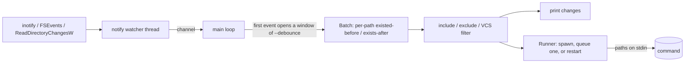

# filewatch

Filesystem change monitoring with debouncing and safe command execution.

<details>
<summary><strong>Contents</strong></summary>

- [Why](#why)
- [Usage](#usage)
- [Options](#options)
- [How changes are reported](#how-changes-are-reported)
- [Running commands](#running-commands)
- [Overflow](#overflow)
- [Output](#output)
- [Exit codes](#exit-codes)
- [Platform notes](#platform-notes)
- [Limitations](#limitations)
- [How it works](#how-it-works)

</details>

## Why

| Problem with common approaches | filewatch |
|---|---|
| Editors save via temp files and renames, so one save produces 3–6 raw events | Per-path coalescing in a debounce window: one change per file per batch, and temporary files disappear |
| `inotifywait` loops pass file names through a shell, so names with spaces or `$(…)` break or inject | No shell is involved; changed paths go to the command's **stdin**, one per line |
| Rebuild commands pile up or run concurrently during bursts of changes | Runs never overlap. Changes during a run queue **one** follow-up run, or `--restart` kills and restarts the command |
| Event queue overflow drops changes silently | Overflow is reported explicitly and triggers the command |

## Usage

```sh
filewatch                                   # watch the current directory, print changes
filewatch src tests -i '*.rs' -- cargo test
filewatch . -e target -e node_modules --json >> changes.jsonl
filewatch config/app.toml -- systemctl reload myapp
filewatch dropbox --once -- ./process-arrivals.sh
```

The command comes after `--`. It runs directly, without a shell. To use shell features, call one explicitly, e.g. `-- sh -c 'make && ./run'`.

## Options

| Option | Default | Meaning |
|---|---|---|
| `PATH...` | `.` | Files or directories to watch. |
| `-i, --include GLOB` | all | Report only matching paths (repeatable). Without `/`, the glob matches names; with `/`, paths relative to the watched root. `*`, `?`, `**`. |
| `-e, --exclude GLOB` | — | Ignore matching paths (repeatable). A name pattern also excludes everything below a matching directory (`-e target`). |
| `--no-vcs-ignore` | off | Also report changes inside `.git`, `.hg` and `.svn`, which are ignored by default. |
| `-N, --no-recursive` | off | Watch directories without their subdirectories. |
| `-d, --debounce` | `100ms` | Window after the first event during which further events join the same batch. |
| `-r, --restart` | off | Kill a still-running command and start it again on new changes. By default, one follow-up run is queued. |
| `-s, --run-on-start` | off | Run the command once at startup. |
| `-1, --once` | off | Exit after the first batch and its command run. |
| `--json` | off | JSON Lines output. |
| `-q, --quiet` | off | No change lines or command status (errors still go to stderr). |

## How changes are reported

Within a batch, each path ends up with at most one change, based on whether it existed at the start and at the end of the batch:

| Events in the batch | Reported |
|---|---|
| create (+ modifies) | `created` |
| modifies | `modified` |
| remove | `removed` |
| create … remove | nothing (a transient file) |
| remove … create | `modified` |
| rename `a → b` | `removed a`, `created b` |
| editor save: write `x.swp`, rename to `x` | `created x` (the OS reports a new file at `x`) |

Paths are shown relative to the watched root they belong to. Access-only events (reads) are ignored.

**macOS.** FSEvents accumulates event flags per path and can replay events from just before the watch started, so the kind of event cannot be trusted there. On macOS, each changed path is resolved from the filesystem's state at the end of the batch:
- missing → `removed`;
- exists and was born within the batch window (allowing 250 ms for FSEvents latency) → `created`;
- otherwise → `modified`.

One consequence: a transient file (created and removed within a batch) shows up as `removed` on macOS, where Linux and Windows drop it. Events for a watched root itself are ignored on every platform.

## Running commands

- **No shell.** `argv` is executed as given.
- **Input.** Changed paths, relative to their root and one per line, are written to the command's stdin, followed by EOF. `FILEWATCH_CHANGED` holds the number of paths. With `--run-on-start`, the first run gets empty input.
- **No overlap.**
  - Default: changes that arrive during a run are merged (deduplicated) into **one** queued run that starts when the current one exits.
  - `--restart`: the running command is killed, waited for (up to 5 s), and started again with the new changes.
- **Status.** A non-zero exit is reported on stderr. filewatch keeps watching.

## Overflow

If events arrive faster than they are read, the OS event queue can overflow (on Linux, at `fs.inotify.max_queued_events`). filewatch then reports an `overflow` event for each watched root and runs the command with the root paths as input, meaning "assume anything may have changed". Changes are never dropped silently. This was verified by pausing filewatch while writing 500 files with a 64-event queue: one `overflow` event was reported.

## Output

```text
2026-11-25T15:05:50Z  CREATED  src/a.rs
2026-11-25T15:05:52Z  OVERFLOW /srv/data  (events were lost; treat everything under it as changed)
```

```json
{"time":"2026-11-25T15:05:50Z","event":"created","path":"src/a.rs"}
```

`event` is one of `created`, `modified`, `removed`, `overflow`.

## Exit codes

| Code | Meaning |
|---|---|
| 0 | Stopped (Ctrl+C, or after `--once`). |
| 1 | A path could not be watched, or the watcher could not start. |
| 2 | Usage error. |

## Platform notes

| | Linux | macOS | Windows |
|---|---|---|---|
| Mechanism | inotify (one watch per directory) | FSEvents | ReadDirectoryChangesW |
| Limits | `fs.inotify.max_user_watches` (watched directories), `max_queued_events` | — | buffer overflow reported as rescan |

Large trees on Linux may need a higher `fs.inotify.max_user_watches`. CI builds and tests on Linux, Windows and macOS. The command-supervision tests (queue and restart) use `sh` and run on Unix only.

## Limitations

- On network filesystems (NFS, SMB), events from other machines are usually not delivered. That's an OS limitation; there is no polling fallback yet.
- Moving a directory *into* the watched tree reports the directory itself, not each file inside it.
- `--restart` kills only the direct child process, not the processes it spawned.
- macOS: transient files are reported as `removed` (see above).

## How it works



While idle, the main loop blocks on the event channel. Only while a command is running does it wake every 50 ms to reap the child.
